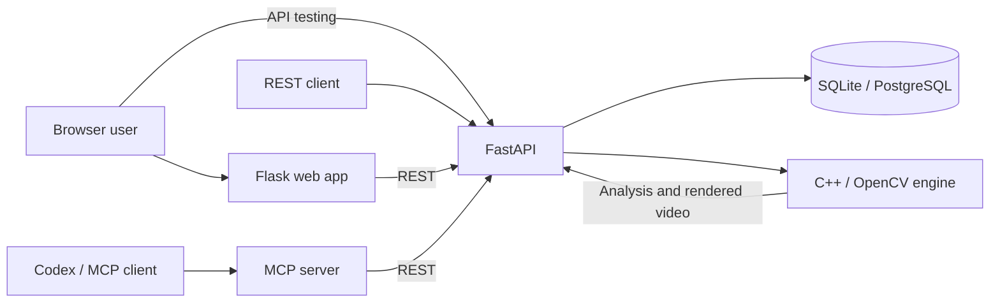

# Automated Video Editor

[](LICENSE)


<div align="center">
  
</div>

Keep the continuous clear main shot between blurry sections.

- **[🌐 Web Browser](http://ai-video-editor-dev.eba-h39e23yp.us-east-1.elasticbeanstalk.com/)**
- **[🤖 MCP Server](#mcp-server-setup)**.

Originally developed to automate repetitive editing tasks in a professional video production environment, significantly cutting hours worked and reducing manual editing time by approximately **60%**. The original C++ computer vision application was later extended into a web-based system with REST APIs, database persistence, cloud deployment, and MCP integration.

## Demo GIF

A 20-second before-and-after showcase using the application with real footage.


## Features

- Uses C++/OpenCV face and blur detection algorithms, retaining the first *sustained clear shot.
- Uploads and combines multiple qualifying clips into one MP4.
- Provides a browser app with functionality to edit blur threshold and video length with a direct download.
- Connect to MCP server with Codex/Claude Code, and edit videos with natural-language instructions.
- Saves job status and edit decisions in SQLite locally or PostgreSQL in deployment.

## Quick Start

**🚀 Get started with the Automated Video Editor in minutes!**

### Requirements

- Docker and Docker Compose
- Or, for a native build: Python 3.12+, CMake, a C++17 compiler, OpenCV, and `nlohmann-json`

Start the browser app and its local database:

```bash
docker compose up --build
```

Open the [browser editor](http://127.0.0.1:8002/) or the [FastAPI developer page](http://127.0.0.1:8000/docs).

The native C++ sources are organized under `src/`: `src/core` contains the
blur-detection algorithm, `src/desktop` the original desktop workflow, and
`src/engine` the headless JSON engine. To build locally:

```bash
brew install cmake opencv nlohmann-json
python3 -m venv .venv && source .venv/bin/activate
pip install -r requirements.txt
cmake -S . -B build && cmake --build build --parallel
export VIDEO_ENGINE_BIN="$PWD/build/video_engine"
uvicorn api.app.main:app --reload
```

## MCP Server Setup

The MCP server provides seven tools that allow AI agents such as Codex to upload, analyze, trim, and compile videos through natural-language requests.

| Tool | Functionality |
|------|---------------|
| `upload_video` | Upload a local video file and create a job |
| `analyze_video` | Detect clear footage with configurable thresholds and duration |
| `adjust_edit` | Reanalyze with simpler blur and clip-length preferences |
| `get_job_status` | Retrieve job status, analysis, and editing decisions |
| `render_video` | Export previously selected cuts |
| `compile_videos` | Analyze and combine already-uploaded clips |
| `edit_videos` | Complete upload-to-final-video workflow in one call |

With FastAPI running on port 8000, register the local MCP adapter with Codex:

```bash
codex mcp add ai-video-editor \
  --env API_BASE_URL=http://127.0.0.1:8000 \
  -- "$PWD/.venv/bin/python" "$PWD/mcp_server/server.py"
```

Restart Codex and verify the connection with `/mcp`. Then ask it to edit clips:

```text
Use edit_videos to edit these clips for me:
/absolute/path/clip-one.mov
/absolute/path/clip-two.mov
```

## Architecture



The Flask app and MCP server call FastAPI; they do not implement separate
editing logic. FastAPI manages uploads and jobs, while the C++ engine detects
blur and renders the selected footage.

## Testing \& Deployment

GitHub Actions runs **CI** on every push and pull request. It installs dependencies, runs the API and C++ tests, and builds the Docker image to catch problems before merging.

**CD** runs after a successful CI check on `main`. It packages that commit, deploys it to AWS Elastic Beanstalk, and checks that the deployed app responds. Deployment requires the AWS role and GitHub environment settings described in the deployment guide (aws/elastic-beanstalk/README.md).

To run the main checks locally:

```
pytest api/tests -q
cmake -S . -B build && cmake --build build --parallel
ctest --test-dir build --output-on-failure
```

## License

See [LICENSE](LICENSE).
