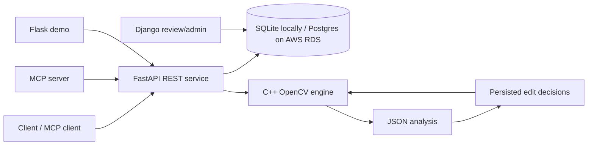

# Automated Video Editor

[](LICENSE)
[](https://github.com/matttavares9/AI-Video-Editor)


<div align="center">

</div>

A web-based and MCP-enabled application that automatically analyzes video footage and removes blurry or unwanted segments.

[🌐 Web Application](http://ai-video-editor-dev.eba-h39e23yp.us-east-1.elasticbeanstalk.com)
[🤖 MCP Server](#mcp-server-setup)

## Demo
A 20 second **before and after** showcase using the application with real footage.


## What it does

1. **Upload** a video to `POST /jobs`.
2. **Analyze** it with a headless C++/OpenCV executable. The engine accepts a
   JSON job specification and writes JSON analysis—no prompts, windows, or
   hardcoded file paths.
3. **Validate** the C++-selected cut against the requested minimum duration
   and maximum total duration. The Python service does not select replacement
   footage.
4. **Inspect status** at `GET /jobs/{job_id}`. Jobs and approved cut decisions
   are persisted in SQLite locally and can use Postgres in deployment.
5. **Export** an MP4 with `POST /jobs/{job_id}/export`.

## Architecture



The same diagram is available in [docs/architecture.md](docs/architecture.md).

## Choose an interface

The C++ selection algorithm is identical in all three interfaces. Choose the
one that matches the person using the project:

| Interface | Intended user | What they do |
| --- | --- | --- |
| [FastAPI `/docs`](#1-developer-test-page-fastapi-docs) | Developer / reviewer | Call and inspect each API operation directly. |
| [Flask website](#2-browser-website) | Regular browser user | Upload clips, click **Edit automatically**, download the result. |
| [Codex MCP](#3-codex-mcp) | Codex user | Ask Codex to edit clips in natural language. |

## Quick start

### Prerequisites

- Python 3.12+
- CMake 3.20+
- C++17 compiler
- OpenCV development package
- `nlohmann-json` development package

macOS example:

```bash
brew install cmake opencv nlohmann-json
python3 -m venv .venv
source .venv/bin/activate
pip install -r requirements.txt
cmake -S . -B build
cmake --build build --parallel
export VIDEO_ENGINE_BIN="$PWD/build/video_engine"
uvicorn api.app.main:app --reload
```

Keep this terminal running, then use one of the three interfaces below.

### 1. Browser website

The Flask website is a small, functional browser client. It uploads one or
more clips to FastAPI, automatically analyzes/trims/joins qualifying clips,
and streams the finished download back to the browser. It contains no editing
logic of its own.

With Docker installed, start the complete local stack in a second terminal:

```bash
docker compose up --build
```

Open `http://127.0.0.1:8002/`, choose clips, optionally change the blur
threshold or maximum length, and click **Edit automatically**. A threshold of
**5** is the default; lower numbers allow more blur in the retained footage.

### 2. Codex MCP

The MCP server is a local `stdio` adapter over the FastAPI service. In a
second terminal, with the FastAPI server from Quick start still running:

```bash
cd /path/to/Automated-Video-Editor
codex mcp add ai-video-editor \
  --env API_BASE_URL=http://127.0.0.1:8000 \
  -- "$PWD/.venv/bin/python" "$PWD/mcp_server/server.py"
codex mcp list
```

Restart Codex (or start a new Codex session) and use `/mcp` to confirm that
**ai-video-editor** is connected. Then give Codex a prompt such as:

```text
Use edit_videos to edit these clips for me:
/absolute/path/clip-one.mov
/absolute/path/clip-two.mov
```

Codex calls `edit_videos`, which uploads the clips, automatically analyzes and
trims every qualifying clip, then joins them into one MP4. It can also adjust
an existing upload: “allow a bit more blur and make the clip longer.” That
maps to `adjust_edit(blur_tolerance="more", clip_length="longer")`.

## Headless C++ engine

The engine is intentionally usable without Python:

```bash
./build/video_engine analyze --job job.json --output analysis.json
./build/video_engine render --job render.json --output export.json
```

`job.json` example:

```json
{
  "input_path": "/absolute/or/relative/path/to/input.mp4",
  "min_clip_seconds": 4,
  "max_total_duration_seconds": 8
}
```

The engine calls `Clip::Create`, which uses `Clip::FindNotBlurry`. It writes
source metadata, the sampled blur measurements, and the selected main shot to
JSON. `render.json` adds `output_path` and the accepted `cuts`. Optional
`face_cascade_path` enables the original face-first adjustment within that shot.

A clear section shorter than the minimum produces an empty cut list, not an
invented highlight. For footage with a roughly three-second clear section,
explicitly use `"min_clip_seconds": 2`. The default remains four seconds.
The API applies an exact centered duration cap to the selected clear shot.
Sampling remains at half-second intervals.

## Django, Flask, and Docker

```bash
docker build -t ai-video-editor .
docker run --rm -p 8000:8000 -v "$PWD/data:/data" ai-video-editor
```

For the complete local stack—FastAPI, PostgreSQL, Django review/admin, and the
small Flask dashboard—run:

```bash
docker compose up --build
```

- FastAPI developer test page: `http://127.0.0.1:8000/docs`
- Django review/admin: `http://127.0.0.1:8001/`
- Flask browser website: `http://127.0.0.1:8002/`

Django's models are intentionally read-only views of the FastAPI SQL tables;
there is one job record and one source of editing decisions.

## AWS and CI/CD

For AWS deployment, follow [aws/elastic-beanstalk/README.md](aws/elastic-beanstalk/README.md).
The Elastic Beanstalk environment exposes the Flask browser interface and keeps
FastAPI and the C++ editor private inside the same container. The MCP adapter
runs locally. CI tests the application on pushes and pull requests. The CD
workflow deploys the tested main-branch commit to Elastic Beanstalk after CI
succeeds; see the deployment guide for its AWS and GitHub configuration.

The Elastic Beanstalk nginx configuration accepts uploads up to 100 MB. For
larger production files, use direct-to-S3 multipart uploads instead of routing
the media through the API server.

## Quality checks

```bash
pytest api/tests -q
cmake -S . -B build && cmake --build build --parallel
ctest --test-dir build --output-on-failure
docker build -t ai-video-editor .
```

GitHub Actions runs these checks on every push and pull request.

## License

See [LICENSE](LICENSE).
