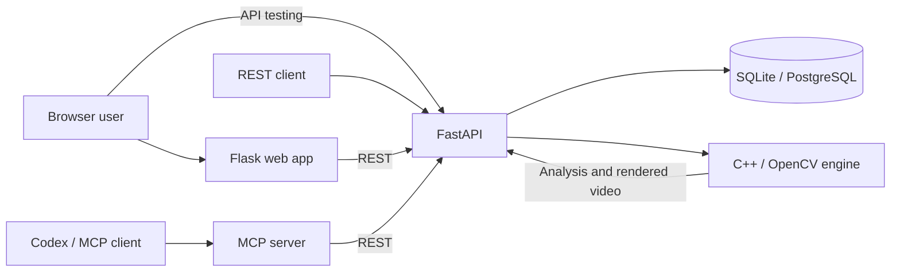

# Automated Video Editor

[](LICENSE)


<div align="center">
  
</div>

**Keep the continuous clear main shot between blurry sections.** The editor
uses an original C++/OpenCV algorithm to find and trim a sustained clear shot
from video clips, then joins qualifying clips into an MP4.

## Live App + MCP Setup Links

- [Open the live web application](http://ai-video-editor-dev.eba-h39e23yp.us-east-1.elasticbeanstalk.com)
- [Set up the MCP server](#mcp-server-setup)

## Demo GIF

A 20-second before-and-after showcase using the application with real footage.


## Features

- Detects blur using the original C++/OpenCV algorithm and retains the first sustained clear shot.
- Uploads and combines multiple qualifying clips into one MP4.
- Provides a browser app, FastAPI endpoints, and a Codex MCP interface.
- Saves job status and edit decisions in SQLite locally or PostgreSQL in deployment.

## Architecture



The Flask app and MCP server call FastAPI; they do not implement separate
editing logic. FastAPI manages uploads and jobs, while the C++ engine detects
blur and renders the selected footage. See [the architecture notes](docs/architecture.md).

## Quick Start

### Requirements

- Docker and Docker Compose
- Or, for a native build: Python 3.12+, CMake, a C++17 compiler, OpenCV, and `nlohmann-json`

Start the browser app and its local database:

```bash
docker compose up --build
```

Open the [browser editor](http://127.0.0.1:8002/) or the [FastAPI developer page](http://127.0.0.1:8000/docs).

The native C++ sources are organized under `src/`: `src/core` contains the
blur-detection algorithm, `src/desktop` the original desktop workflow, and
`src/engine` the headless JSON engine. To build locally:

```bash
brew install cmake opencv nlohmann-json
python3 -m venv .venv && source .venv/bin/activate
pip install -r requirements.txt
cmake -S . -B build && cmake --build build --parallel
export VIDEO_ENGINE_BIN="$PWD/build/video_engine"
uvicorn api.app.main:app --reload
```

## MCP Server Setup

With FastAPI running on port 8000, register the local MCP adapter with Codex:

```bash
codex mcp add ai-video-editor \
  --env API_BASE_URL=http://127.0.0.1:8000 \
  -- "$PWD/.venv/bin/python" "$PWD/mcp_server/server.py"
```

Restart Codex and verify the connection with `/mcp`. Then ask it to edit clips:

```text
Use edit_videos to edit these clips for me:
/absolute/path/clip-one.mov
/absolute/path/clip-two.mov
```

## Testing & Deployment

Run the Python and C++ checks:

```bash
pytest api/tests -q
cmake -S . -B build && cmake --build build --parallel
ctest --test-dir build --output-on-failure
```

GitHub Actions runs tests and builds the Docker image on pushes and pull
requests. For AWS Elastic Beanstalk deployment, see the
[deployment guide](aws/elastic-beanstalk/README.md). The browser interface is
public; the FastAPI service and C++ engine remain private inside the container.

## License

See [LICENSE](LICENSE).
